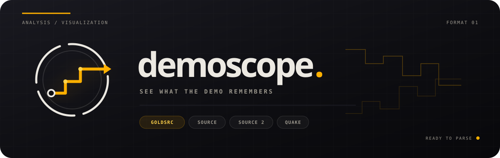

<p align="center">
  
</p>

Fast, pure-Rust parser and interactive 3D visualiser for game demo files across four engine families: built with a handful of pure-Rust crates and no C toolchain.

- **Source 1 (HL2DEMO)** - Team Fortress 2, Half-Life 2 (all versions), Counter-Strike: Source, Counter-Strike: Global Offensive, Day of Defeat: Source, Portal, Portal 2, The Stanley Parable, Left 4 Dead 1/2, and Garry's Mod (`GMODEMO`). Decodes player positions, inputs, game events, per-player entity tracks, and (CS:S / CS:GO) economy + scoreboard into a full visualisation.
- **Source 2 (PBDEMS2)** - Counter-Strike 2, Dota 2, Deadlock. Per-player world positions, names, death/respawn, game events, and economy + scoreboard, plus a **CS2 map overlay** decoded from the map's `.vpk` (VPK → Source 2 resource → KV3 → world-collision mesh).
- **GoldSrc (HLDEMO)** - Half-Life 1, Counter-Strike 1.6, Day of Defeat, Condition Zero. Recorder POV camera + map overlay.
- **Quake family** - Quake 1 (NetQuake), Quake 2, and Quake 3 Arena, with per-player tracks and map overlays.

All four render through the same viewer (3D scene, minimap, heatmap, POV camera, scoreboard, kill arcs). The world geometry is drawn behind the paths from a matching map file placed beside the demo: a `.bsp` for Source 1 / GoldSrc / Quake (VBSP, GoldSrc/Q1 v30/v29, Quake 2 `IBSP` v38, Quake 3 `IBSP` v46), or the map's `.vpk` for CS2.

See the **[full compatibility matrix](docs/COMPATIBILITY.md)** for per-game status.

---

## Installation

Download a pre-built binary from the [Releases](https://github.com/programmer1o1/demoscope/releases) page (Windows, macOS, Linux), or build from source:

```bash
cargo build --release
# binary: target/release/demoscope
```

Requires Rust stable (≥ 1.85). No external system libraries and no C toolchain are needed because every dependency is pure Rust. The CLI pulls only `base64`, `lzma-rs`, and `ruzstd` (a pure-Rust zstd decoder, used for CS2 map resources); the WASM build adds `wasm-bindgen` and `console_error_panic_hook` (gated to `target_arch = "wasm32"`). Everything engine-specific, including the protobuf reader, Snappy, and the Source 2 KV3/VPK stack, is hand-rolled in-tree.

### WASM (in-browser) build

demoscope also compiles to WebAssembly, exposing the parser to JavaScript so users can drag a `.dem` onto a webpage and skip the CLI entirely.

```bash
rustup target add wasm32-unknown-unknown
cargo install wasm-bindgen-cli   # matching version in Cargo.lock
./scripts/build-wasm.sh
python3 -m http.server 8088 --directory web
# open http://localhost:8088/
```

Drop a `.dem` (and optionally the matching `.bsp`) onto the page. The viewer renders entirely in your browser - files never leave your machine. WASM parse time is ~5-8× slower than the native CLI (a 14 MB demo parses in ~1.6 s on Apple Silicon vs ~250 ms native), but for sharing demos with someone who doesn't have the CLI installed it's a meaningful upgrade.

Build artifacts land in `web/` (the `.wasm` + JS glue are gitignored and built fresh - only `web/index.html` is committed). The `.github/workflows/pages.yml` workflow runs `build-wasm.sh` and deploys `web/` to GitHub Pages on every push to `master`, so the hosted viewer always matches source (enable it once under repo Settings → Pages → Source: "GitHub Actions"). The library entry point is `pub fn parse_demo_to_html(demo: &[u8], bsp: Option<Vec<u8>>, name_hint: &str, jump_threshold: f32) -> Result<String, JsValue>` in `src/lib.rs`.

---

## Usage

```
demoscope <demo-file> [OPTIONS]
```

| Flag | Description |
|------|-------------|
| *(none)* | Source 1: print usercmds; other formats: print a summary and HTML hint |
| `--all` | Also print non-usercmd packets (signon, packet, synctick, …) |
| `--csv` | Output usercmds as CSV (one row per frame) |
| `--json` | Output usercmds as a JSON array |
| `--summary` | Print header info and packet counts only |
| `--html [FILE]` | Generate self-contained interactive 3D HTML visualisation (always includes multi-player tracks) |
| `--diff FILE` | Overlay a second Source demo as translucent ghost tracks |
| `--diff-split FILE` | Compare two Source demos in a synchronized split viewer |
| `--map FILE` | Add a BSP/VPK map layer; repeat for multi-map GoldSrc viewers |
| `--jump-threshold N` | Override the automatically derived path-break distance |
| `--check FILE_OR_DIR` | Run the decoder self-check and fail if any demo cannot be decoded |

### Examples

```bash
# Quick header check
demoscope demo.dem --summary

# Human-readable per-frame breakdown
demoscope demo.dem

# Pipe into other tools
demoscope demo.dem --csv | head -5
demoscope demo.dem --json | jq '.[0]'

# Generate interactive 3D HTML viewer (multi-player included)
demoscope demo.dem --html
# → demo.html  (open in any browser, no server needed)

# Custom output path
demoscope demo.dem --html /tmp/out.html

# Load several Half-Life/GoldSrc maps into one viewer
demoscope meow.dem --html --map c1a0.bsp --map c1a1.bsp --map c1a2.bsp

# Override the automatically derived path-break threshold
demoscope demo.dem --html --jump-threshold 400
```

The CSV columns are documented in [docs/FORMAT.md](docs/FORMAT.md#csv-column-reference).

---

## HTML visualisation

`demoscope --html` produces a single HTML file with all demo data embedded. Viewer libraries are loaded from a CDN, so the first open requires a network connection; they work offline afterward when the browser cache is available.

Place the `.bsp` map file in the same directory as the demo for the full 3D map overlay. Source VBSP (incl. LZMA-compressed lumps common in TF2 workshop maps), GoldSrc / Quake 1 (v30 / v29), Quake 2 (`IBSP` v38), and Quake 3 (`IBSP` v46) maps are all decoded automatically by version. Quake 3 maps ship inside a `.pk3` - extract `maps/<name>.bsp` and place it beside the demo.

For campaigns split across several GoldSrc maps, repeat `--map FILE` or drop
multiple BSPs into the browser. All layers render together in their native map
coordinates; automatic landmark-based alignment is not yet implemented.

### Controls

| Input | Action |
|-------|--------|
| Left-drag | Orbit |
| Scroll | Zoom |
| Right-drag | Pan |
| Space | Play / pause |
| Timeline scrubber | Seek |

### Features

| Section | Content |
|---------|---------|
| **3D scene** | Full BSP map mesh (incl. displacement terrain) + per-player path |
| **Playback** | Play/pause, speed 0.5×-10×, timeline scrubber |
| **Metadata header** | Map, game, client, server name, duration, tickrate, demo protocol, usercmd / life / death / teleport counts |
| **Speedometer** | Real engine-derived horizontal velocity (current + peak) computed from `viewOrigin` deltas |
| **Players panel** | Sidebar entry per detected player. Click to toggle their path; right-click to set as primary (controls camera follow + Lives panel) |
| **Lives panel** | Primary player's alive intervals from `m_lifeState`; click any row to seek |
| **Deaths** | Off → YOU (primary only) → ALL three-state toggle |
| **Rounds** | Auto-detected round windows. Prev/Next/All buttons, per-round seek, timeline shading |
| **Camera modes** | Orbit · Follow Player · First Person |
| **Player avatars** | Simple coloured box per entity. Primary tinted blue; YOU tag in the sidebar |
| **Fire markers** | Toggle small spheres at every `IN_ATTACK` rising edge, coloured by `weaponselect` |
| **Kill arcs** | `Kills` toggle draws a bezier arc from attacker → victim at each kill, lit up during playback (headshots gold, body shots orange-red) with an on-screen colour legend. Needs multi-player entity tracks |
| **Teleport arcs** | Cyan bezier arcs for teleporter / Eureka Effect events |
| **Minimap** | 2D top-down overlay with per-player paths, death markers, and current-position dots. `Heatmap` button overlays a log-scaled density grid (per-entity when MP is active) |
| **Event log** | Scrollable table of parsed game events - click a row to seek |
| **Console** | Chat + kills + spawns + rounds + connects in a Source-style log. Filter chips per category; expand-to-fullscreen button (⛶) auto-scrolls during playback |
| **GIF export** | `Record GIF` captures the canvas at configurable speed/fps/duration. Optional HUD overlay composites the minimap + player name onto every frame |
| **Video export** | `Record Video` records MP4/H.264 (preferred) or WebM/VP9/VP8 via the `MediaRecorder` API. Higher quality and smaller files than GIF |
| **Active weapon readout** | Below the WASD/M1 panel: shows which weapon the primary player is holding, derived from `m_hActiveWeapon` and the wielded entity's class name |
| **Hide specs toggle** | Players panel button that suppresses bots / observers / HLTV / recorder-while-spectating from the 3D scene + minimap + death markers. Combines a < 3-sample-count heuristic with the `svc_SetView` spectator-switch intervals so CS:S recorders don't render on top of whoever they're watching |

### Game-aware event filtering

`demoscope` reads the demo's `game_dir` and selects an appropriate event set. Custom filters for: `tf`, `cstrike` / `csgo`, `left4dead` / `left4dead2`, `portal` / `portal2`, `hl2mp`, plus a generic Source fallback.

---

## Documentation

| Doc | Contents |
|-----|----------|
| [docs/COMPATIBILITY.md](docs/COMPATIBILITY.md) | Per-game support matrix and release-verification guidance |
| [docs/FORMAT.md](docs/FORMAT.md) | Demo file format, packet layout, UserCmd bit format, button masks, proto-4 SendTable/PacketEntities wire format, CSV columns, decode notes |
| [docs/PROTO4.md](docs/PROTO4.md) | How proto-4 (Portal 2 / Stanley / L4D) decode was reverse-engineered, plus the env-gated trace switches for investigating a new proto-4 game |
| [CHANGELOG.md](CHANGELOG.md) | Release notes and the full list of completed work |
| [ROADMAP.md](ROADMAP.md) | Planned work |
| [CREDITS.md](CREDITS.md) | Reference implementations, format docs, RE tooling, and demo contributors |
